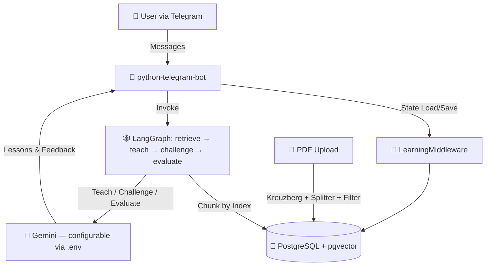

# 🧠 The Socratic Learning Agent

> **A Personal Tutor Agent powered by LangGraph, Gemini, and PostgreSQL + pgvector.**
> **Status:** 🟢 Working (large-book LLM verification pending API quota) | **Version:** 0.3.0

An AI-driven learning system that turns text-based PDFs — from short papers to 500-page books — into an interactive, Socratic learning journey over Telegram. Unlike standard RAG bots that just retrieve answers, this agent **teaches each section, quizzes your understanding, and tracks how well every concept sticks** before moving on.

---

## 🚀 What It Does

1. **Upload a PDF** in Telegram (text-based, ≤ 20 MB).
2. The book is **extracted, split into lesson-sized sections**, and front/back matter (TOC, preface, copyright, index, references) is **filtered out** — you learn the chapters, not the boilerplate.
3. You get a lesson plan ("42 lesson sections, ~2 hours of study").
4. For each section the tutor runs a **teach → challenge → evaluate** cycle:
   - **Teach:** a structured explanation (hook → core idea → takeaways) in your chosen style.
   - **Challenge:** one application-level question — never yes/no, never pure recall.
   - **Evaluate:** rubric-based grading with a Socratic hint; your mastery score decides whether you advance, retry, or (after 3 attempts) move on.
5. Mastery, attempts, and struggle points are **persisted per concept** — your session survives across chats and restarts.

## ✨ Key Features

- **📚 Book-Scale Ingestion:** Kreuzberg v4 extraction + size-based chunking — no per-sentence embedding calls, so a 500-page book ingests in seconds (chunking) and ~a minute (embeddings, batched with rate-limit backoff).
- **🧹 Front/Back Matter Filter:** char-weighted heuristics + a cheap LLM classification pass keep only teachable content. Degrades gracefully: if the LLM is unavailable, everything is kept and the book still works.
- **🤖 Stateful Learning Flow:** LangGraph orchestrates retrieve → teach → challenge → evaluate with mastery-gated routing (`MASTERY_THRESHOLD = 0.85`, `MAX_RETRIES = 3`).
- **📈 Mastery Tracking:** per-concept mastery score (`M_new = M_old + ((1 − M_old) × accuracy) / (1 + attempts)`), attempts, and struggle points in PostgreSQL.
- **💬 Telegram Interface:** markdown rendered as Telegram HTML (bold, italics, code, bullets) with a plain-text fallback; staged progress messages during ingestion.
- **🎨 Teaching Styles:** `/style ELI5 | ANALOGY_HEAVY | TECHNICAL | SOCRATIC` (default Socratic), persisted per user.
- **🧠 Continuity:** lessons reference the previous section; quiz questions use recent conversation history.

## 💬 Commands

| Command | Effect |
|---|---|
| `/start` | Welcome + how to use the bot |
| `/style` | List teaching styles / show current |
| `/style ELI5` | Switch teaching style (applies next lesson) |
| `/status` | Show the latest document and your live session |
| `/reset` | Abandon the current lesson and start fresh |

Uploading a new PDF always resets the session automatically.

---

## 🏗️ Architecture

The database is the single source of truth for both knowledge and user state; the LangGraph state itself is round-tripped through a JSON column.



**Ingestion pipeline** (`src/engine/`): Kreuzberg extraction → `RecursiveCharacterTextSplitter` (2200 chars / 200 overlap) → heuristic + LLM front/back-matter filter → batched embeddings (90/request, 429 backoff) → pgvector.

**Learning graph** (`src/agents/graph.py`): an entry router sends each message to the right node — grading when a question is pending, teaching when a new section starts — and `advance`/`retry`/`complete` decisions are driven by mastery scores, not just correctness.

---

## 🚦 Getting Started

**Prerequisites:** Docker (everything runs in containers).

```bash
# 1. Configure — required keys:
cp .env.example .env   # if you don't have a .env yet
#   GEMINI_API_KEY      → https://aistudio.google.com/
#   TELEGRAM_BOT_TOKEN  → @BotFather on Telegram

# 2. Run
docker compose up --build
```

The app container runs `src/main.py` → `init_db()` (creates the pgvector extension + all tables) → Telegram polling. The DB alone: `docker compose up -d db`.

> ⚠️ **Free-tier reality:** ~20 `generate_content` requests/day on flash models. One teach→quiz turn costs 2–3 requests. Pro models are zero-quota on free keys — set `LLM_MODEL=gemini-3.1-pro-preview` in `.env` if your key has billing.

## ⚙️ Configuration (`.env`)

| Variable | Default | Purpose |
|---|---|---|
| `GEMINI_API_KEY` | — | Required. Gemini API key |
| `TELEGRAM_BOT_TOKEN` | — | Required. Bot token from @BotFather |
| `LLM_MODEL` | `gemini-3.5-flash` | Teaching/eval model (verified on free tier; JSON mode included) |
| `EMBEDDING_MODEL` | `models/gemini-embedding-001` | Embedding model, pinned to 768 dims (must match `Vector(768)` in `models.py`) |
| `DATABASE_URL` | points at `db` container | Postgres connection |
| `LOG_LEVEL` / `DEBUG` | `INFO` / `False` | App settings |

---

## 📁 Project Structure

```
src/
├── main.py               # Entrypoint (Dockerfile CMD): init_db → Telegram polling
├── interface/
│   ├── telegram_bot.py   # Handlers: /start /style /reset, PDF gate, ingestion, replies
│   └── middleware.py     # AgentState ⇄ Postgres persistence (JSON-serializable)
├── agents/
│   ├── graph.py          # LangGraph: routing, teach/challenge/evaluate nodes, mastery math
│   └── state.py          # AgentState + MasteryRecord schemas
├── engine/
│   ├── extractor.py      # Kreuzberg extraction + lesson-sized splitting
│   ├── filter.py         # Front/back matter removal (heuristics + LLM classification)
│   └── llm.py            # Gemini wrapper: teach / challenge / evaluate / classify
├── database/
│   ├── connections.py    # Engine, sessions, Base, init_db()
│   ├── models.py         # User, Document, DocumentChunk (pgvector), UserProgress, ConceptMastery
│   └── vector_store.py   # Batched embeddings + cosine search
└── core/
    ├── config.py         # pydantic-settings (.env)
    └── constants.py      # Persona prompts, styles, mastery thresholds
```

## ⚠️ Current Limitations

- **Text-based PDFs only** — no OCR; scanned/blank PDFs are rejected at upload.
- **≤ 20 MB files** (Telegram Bot API limit).
- **No URLs/images** — PDF upload is the only ingestion path for now.
- **Free-tier quota** shapes verification cadence (see AGENTS.md for the full engineering gotchas).
